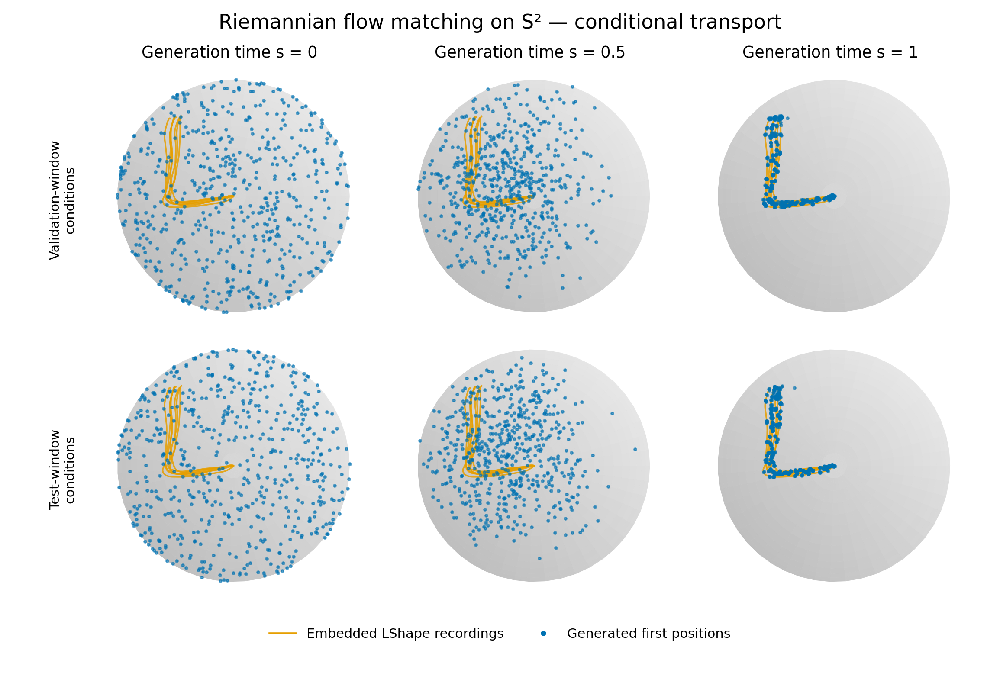

# SafeManifoldFlowMatching

A small research-preparation project on learning and steering robot pointing directions on **S²**. Phase 1 reimplements the original RFMP paper's LASA method; Phase 2 is a proposed generation-time geometric-CBF extension. The applicant approved the proposal, local specification/tickets and TDD interfaces. The total project budget is at most 18 hours.

**Phase 1 is complete and frozen:** all **35/35** autonomous rollouts pass the approved gate (mean goal error **1.20°**, mean angular DTW **1.35°**). The official dataset is checked, the 200-epoch all-context model is trained, and the saved checkpoint reproduces its outputs exactly. The first failed run is preserved. **Phase 2 has not started.** See the [results and limitations](docs/results/phase1_report.md), [frozen manifest](docs/results/phase1_baseline.json) and [six-panel PDF](docs/results/flow_transport.pdf).



[Three animated rollout walkthroughs](docs/results/phase1_animations.md) show complete sampling → tangent flow → selection/advancement cycles using the frozen model (seeds 101, 202 and 303). The three MP4s are included under `docs/results/videos/`; the walkthrough also compares their shapes and angular separation.

Start with the [core methodology](methodology.md), [approved Phase 1 specification](.scratch/rfmp-phase1/spec.md), [tickets](.scratch/rfmp-phase1/ticket_plan.md) and [TDD evidence](docs/phase1_tdd_log.md). Paper details that could not be verified in original author code are explicit reproducibility conventions in the specification.

## Method

Each position chunk lies on the product manifold `(S²)^8`, equipped with the product of canonical round metrics. The network predicts a tangent vector at the current chunk; training compares it with the differentiated source-to-data geodesic in that same tangent space. Sampling uses factorwise sphere-exponential Euler updates.

The model predicts eight future positions, executes four, then replans using its own history. Conditioning comprises the current direction, an earlier direction and normalized index separation. Two recorded positions bootstrap each rollout; no future demonstration positions enter subsequent conditioning. There is no hard endpoint pinning or explicit goal input.

The seven real LShape recordings are resampled to 200 points and embedded through the sphere exponential. Training/validation/test partitions contain 1,108/138/140 recording-reference windows. Their underlying recordings overlap: this measures **within-recording reconstruction, not held-out-recording generalization**. The wrapped-Gaussian source uses tangent covariance `0.5 I` and repeats one sampled direction across a chunk.

Training uses five hidden width-64 layers with learned Swish parameters, Adam at `1e-4`, EMA decay `0.999`, batch size 128 and 200 epochs. Each corrected epoch covers all 109,739 valid training window/context pairs. There are 171,600 optimizer updates; checkpoint selection uses a fixed validation bank. The actual network has 20,317 parameters. Undocumented embedding, indexing, depth and solver choices are recorded in the specification rather than attributed to the authors.

## Reproduce Phase 1

Use Python 3.12 with PyTorch, NumPy, SciPy, Matplotlib and pytest. The measured environment is CPU-only despite a CUDA-enabled PyTorch build. From this repository:

```bash
# Existing scientific environment used for this study:
PY=/home/chengrui/miniconda3/envs/latentSafety/bin/python
$PY -m pytest -q

# Supply the official file at data/raw/LShape.mat, then train and evaluate:
PYTHONPATH=src $PY -u -m safe_manifold_flow \
  --data data/raw/LShape.mat --epochs 200 --context-mode all \
  --output runs/phase1-context-expanded

# Reproduce evaluation/figures without training or overwriting the original run:
PYTHONPATH=src $PY -u -m safe_manifold_flow \
  --data data/raw/LShape.mat \
  --checkpoint runs/phase1-context-expanded/best.pt \
  --output runs/phase1-reproduced
```

Official input: [LASA LShape.mat](https://raw.githubusercontent.com/epfl-lasa/LASAHandwritingDataset/master/DataSet/LShape.mat). Expected SHA-256: `3aa960ed9241d4651c7e21240d63d616d215d889e08ce780fc7a5b1334474ce9`. Respect the [dataset's attribution and academic-use terms](https://github.com/epfl-lasa/LASAHandwritingDataset). Raw/processed records, checkpoints and run artifacts are ignored by Git and are not redistributed. The repository's compatibility path is `application/project/`.

The run directory preserves the checkpoint, train-pair enumeration, split indices, fixed validation/test banks, rollout histories and noise draws, evaluation, configuration/code hashes, and actual plotted samples. The requested six-panel figure shows the same samples at generation times 0, 0.5 and 1, with orange recordings and blue generated first positions. Its two rows use validation-window and test-window conditions; they do not compare RFMP and SRFMP. Autonomous rollout quality is evaluated separately over 35 attempts.

## Phase 2 boundary

The [Phase 2 methodology](methodology_phase2.md) retains the frozen RFMP chunks and replanning loop, adding a minimum-change tangent-velocity CBF filter **inside FM generation**. Everything remains directly on S²: no SO(3) lift, frames or roll variables. The barrier differential and round-metric gradient define the intrinsic QP.

The selected design starts from unconstrained source noise and attempts terminal waypoint recovery, using a slightly expanded internal forbidden cone. Reject an unsafe next execution portion before advancing, stop at the last accepted direction and count the rollout as failed; no fresh-noise retries. Numerical parameters still require specification. Connecting arcs may be unsafe, and dynamic-consistency guarantees are outside scope. A validated, frozen Phase 1 baseline is required before Phase 2 implementation.

## References and audit trail

- [Original RFMP, Braun et al., IROS 2024](https://arxiv.org/abs/2403.10672): inherited LASA chunk-learning method. This is an independent reimplementation with documented paper gaps, not an exact reproduction of unavailable author code.
- [Flow matching and stable RFMP notes](docs/references/flow_matching_and_stability.md).
- [LASA implementation comparison](docs/references/lasa_implementation_comparison.md).
- [SAD-Flower and geometric-CBF notes](docs/references/manifold_safety_references.md).
- [Standalone methodology reviews](docs/reviews/README.md) and [final direct-S² audit](docs/reviews/final_s2_audit.md).

Older whole-trajectory and SO(3) design records are historical and superseded. Previous chain-project outputs were deleted at the applicant's request. This project is a learning/pointing experiment, not evidence of hardware control, deformable manipulation or proven motion safety.
