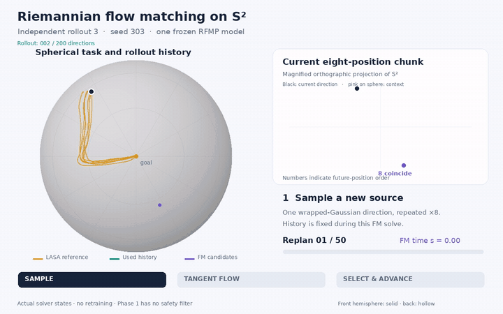
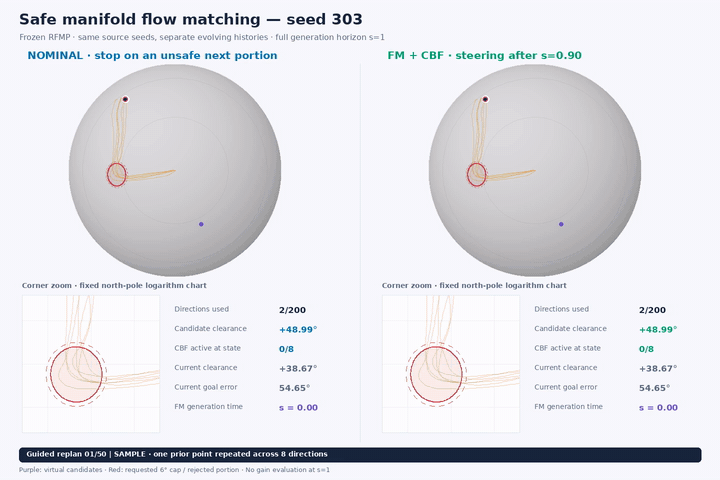
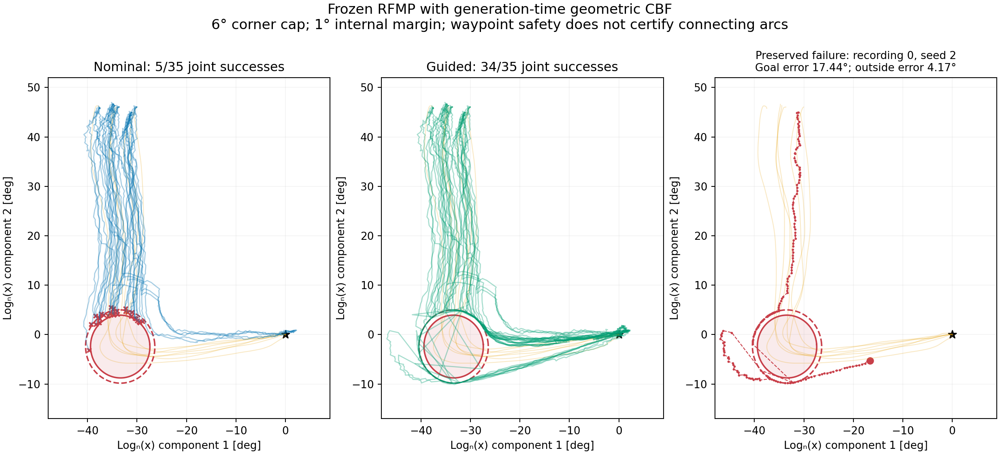

# SafeManifoldFlowMatching

| Flow matching on S² — seed 303 | Safe flow matching on S² — seed 303 |
| --- | --- |
| [](assets/fm_seed_303.mp4) | [](assets/safe_fm_seed_303.mp4) |
| [Watch FM generation and replanning](assets/fm_seed_303.mp4) | [Watch nominal versus CBF-guided generation](assets/safe_fm_seed_303.mp4) |

Looping GIF previews show the full walkthroughs at their original speed, reduced to 720 pixels wide and 8 fps. Click either preview or its link for the full-quality MP4.

We learn short sequences of pointing directions on the sphere, then steer their **generation process** around a forbidden direction. Phase 1 independently implements RFMP's LASA setting [1,2]. Phase 2 combines a geometric CBF [3] with SAD-Flower's virtual-control perspective [4], keeping the trained model frozen.

There are two time axes: **generation time** $s\in[0,1]$ evolves a candidate sequence from noise to a predicted chunk; **rollout index** $k$ advances through accepted directions. Intermediate generation states are not executed.

## Part 1 — Flow matching on the manifold

The data are seven LASA **LShape** recordings [6], resampled to $N=200$ points and embedded on S² through the north-pole exponential map. A training-derived scale sets the maximum training angular radius to 60°. These are handwriting demonstrations used as a pointing task, rather than recorded robot motions.

Each predicted chunk contains eight directions and lies on the product manifold

$$
\mathcal M=(\mathbb S^2)^8,\qquad
T_X\mathcal M=\prod_{i=1}^{8}\{v_i\in\mathbb R^3:x_i^\top v_i=0\},\qquad
g_X(V,W)=\sum_{i=1}^{8}v_i^\top w_i.
$$

The round metric makes the displayed dot products intrinsic inner products on the tangent spaces. The learned field takes values in the tangent bundle $T\mathcal M$; the 24 stored coordinates represent a 16-dimensional manifold.

### Prior: sample in a tangent plane, then map to S²

At the north pole $n=(0,0,1)$, draw a two-dimensional Gaussian tangent and apply the sphere exponential:

$$
\xi=(\xi_1,\xi_2,0)\in T_n\mathbb S^2,\qquad
(\xi_1,\xi_2)\sim\mathcal N(0,0.5I_2),\qquad
z=\mathrm{Exp}_n(\xi),\qquad X_0=(z,\ldots,z).
$$

This is a wrapped-Gaussian prior, with **covariance** $0.5I_2$. One sampled direction is repeated across all eight positions; it is neither a uniform sphere prior nor eight independent draws. Its support is the diagonal of the product manifold.

### Target flow: differentiate the source-to-data geodesic

For a demonstrated future chunk $Y=(y_1,\ldots,y_8)$, interpolate each factor intrinsically:

$$
x_i(s)=\mathrm{Exp}_z\!\left(s\mathrm{Log}_z(y_i)\right),\qquad
u_i(s)=\frac{d}{ds}x_i(s)\in T_{x_i(s)}\mathbb S^2.
$$

We compute this derivative using a Jacobian–vector product (`torch.func.jvp`) through the geodesic. It is the training target velocity at the **current interpolated point**, rather than the initial displacement anchored at $z$. Exact antipodes have no unique shortest-geodesic logarithm and are rejected explicitly.

### Conditioning: current observation and past context

At zero-based rollout index $k$, choose one earlier index $j\in\{0,\ldots,k-1\}$ and hold the condition fixed throughout the generation solve:

$$
o_k=\left[q_k,\ q_j,\ \frac{k+1-j}{N}\right].
$$

This is the implementation's seven-value condition: current direction, past direction and normalized index separation. The model also receives generation time $s$ and the evolving chunk $X_s$. There is no explicit goal or obstacle input. Training targets are the next eight recorded directions, repeating the final recorded direction when the horizon extends past the data.

### Receding horizon: predict eight, use four, replan

Two recorded directions bootstrap the rollout. Each cycle draws a new source, generates eight future directions, uses the first four, then conditions the next solve on its **own generated history**. The unused tail is replaced. Fifty solves produce 200 retained directions; the final execution portion contains two directions. No future demonstration observations are supplied after bootstrap, and no endpoint is pinned.

### Training: match tangent velocities with the product metric

A five-hidden-layer MLP of width 64 predicts ambient vectors, then projects each factor into its current tangent space:

$$
v_{\theta,i}=(I-x_ix_i^\top)f_{\theta,i}(s,X_s,o_k),\qquad
\mathcal L(\theta)=\mathbb E\!\left[
\sum_{i=1}^{8}\|v_{\theta,i}-u_i\|_{g_{x_i(s)}}^2\right].
$$

Both velocities belong to the same tangent fiber, so their difference is geometrically well defined. We sample $s$ uniformly, sum squared errors over the eight factors, and average over the batch.

Training uses Adam at $10^{-4}$, batch size 128, 200 epochs and EMA decay 0.999. Each epoch covers all **109,739 valid training window/context pairs**, giving 171,600 updates. The best EMA checkpoint is selected on a fixed validation bank. The train/validation/test split contains 1,108/138/140 windows; recordings overlap these partitions, so this is **within-recording reconstruction**, without a held-out-recording generalization claim. Undocumented paper details are explicit local reproduction choices.

### Integration: move by the sphere exponential

Sampling solves $dX_s/ds=V_\theta(s,X_s\mid o_k)$ with factorwise exponential Euler:

$$
x_i^{\ell+1}=\mathrm{Exp}_{x_i^\ell}(\Delta s\,v_{\theta,i}^\ell),\qquad
\mathrm{Exp}_x(w)=\cos(\|w\|)x+
\frac{\sin(\|w\|)}{\|w\|}w,
$$

using the continuous limit at $w=0$. The frozen Phase 1 sampler uses 100 updates from $s=0$ to $1$. This follows sphere geodesics at each step; it is not ambient Euler followed by projection.


Orange curves are demonstrations; blue points are generated first positions of eight-position chunks. Columns track the same samples. Rows use validation and test conditions, respectively.

## Part 2 — Safe flow matching

### CBF design on S²

For unit forbidden direction $c$, exclude the spherical cap of angular radius $\vartheta=6^\circ$. Its safe side is described by

$$
h_{\mathrm{actual}}(x)=\cos\vartheta-c^\top x\ge0.
$$

The filter uses an expanded internal radius $\vartheta_{\mathrm{int}}=7^\circ$ to leave a numerical margin. Under the round metric,

$$
h(x)=\cos\vartheta_{\mathrm{int}}-c^\top x,\qquad
a(x)=\mathrm{grad}h(x)=(c^\top x)x-c,\qquad
dh_x[v]=g_x(a,v)=a^\top v.
$$

The gradient is tangent to S². All computation stays on S²; no SO(3) lift, frame or roll variable is introduced.

### Virtual flow and the CBF constraint

Following the generation-time control idea of SAD-Flower, add a virtual tangent input to the frozen learned field:

$$
\frac{dX_s}{ds}=V_\theta(s,X_s\mid o_k)+U_s,\qquad
U_s\in T_{X_s}\mathcal M.
$$

$U_s$ changes the candidate chunk, rather than commanding physical angular velocity or torque. For every predicted direction, constrain its generation derivative:

$$
\frac{dh_i}{ds}=dh_{x_i}[v_i]\ge-\phi(s)h_i,\qquad
\phi(s)=\frac{0.05}{(1-s)^2}.
$$

The final protocol **bypasses the QP before $s=0.9$**. Initial noise and intermediate candidates may be unsafe; the intended recovery concerns the returned directions. Setting the gain to zero would not implement this bypass.

### Filter the flow by a metric-minimal QP

For each sphere factor, solve the minimum-change problem in its current tangent fiber:

$$
\begin{aligned}
v_i^\star={}&\underset{v_i\in T_{x_i}\mathbb S^2}{\mathrm{arg\,min}}
\ \frac12\|v_i-v_{\theta,i}\|_{g_{x_i}}^2,\\
&\text{subject to}\quad g_{x_i}(a_i,v_i)\ge-\phi(s)h_i.
\end{aligned}
$$

For $a_i\ne0$, its closed-form solution is

$$
v_i^\star=v_{\theta,i}+
\max\!\left(0,\frac{-g_{x_i}(a_i,v_{\theta,i})-\phi(s)h_i}
{g_{x_i}(a_i,a_i)}\right)a_i,\qquad
U_i=v_i^\star-v_{\theta,i}.
$$

An already feasible nominal field is unchanged. An unsatisfied constraint with zero gradient is infeasible; an active near-zero gradient is reported as ill-conditioned. We do not hide these cases by clipping the denominator. The corrected velocity is integrated with the same sphere exponential as in Phase 1.

### Finite-step sampling and execution acceptance

Both Phase 2 comparators use the same **1,891-update** grid: spacing 0.001 through 0.99, spacing 0.00001 through 0.999, then one final step to 1. Every field/gain evaluation occurs at a left endpoint **strictly below 1**. The geometric state/filter use float64; the frozen network remains float32. A step exceeding 0.1 rad fails explicitly.

The complete next execution portion must clear the **actual 6° cap** before advancing. Otherwise, reject the entire portion, stop at the last accepted direction and count a failed rollout. There is no partial execution, point repair or fresh-noise retry. All eight predicted positions are filtered; unused-tail violations are recorded separately.

The finite grid and internal margin do not establish a terminal-recovery theorem. Connecting arcs can remain unsafe, and neither physical dynamics nor global goal convergence is guaranteed.

## Results

The cap is placed at the L's corner, with both starts and goals outside it; an antipodal cap supplies the no-conflict control. Each evaluation group contains seven recording bootstraps × five noise seeds, retaining failures in the denominator.

| Experiment | Joint success |
| --- | ---: |
| Frozen Phase 1 RFMP | **35/35** |
| Phase 2, corner cap, matched nominal sampler | 5/35 |
| Phase 2, corner cap, CBF-guided sampler | **34/35** |
| Phase 2, no-conflict cap | **35/35 for both methods** |

Joint success requires a full rollout, valid geometry, goal error ≤5°, angular DTW ≤10°, maximum adjacent jump ≤20°, and, in Phase 2, safe used directions plus mean demonstration deviation ≤3° outside the 12° obstacle neighborhood. Zero unsafe execution obtained by stopping does not count as successful avoidance.

All 35 guided corner rollouts finish and all 1,750 returned chunks clear the actual cap, including unused tails. One run still fails goal/fidelity thresholds: recording 0, seed 2 has goal error **17.44°** and outside-neighborhood deviation **4.17°**. It is shown below rather than discarded. In 105 matched corner chunks, unsafe proposals fall from **35/105 to 0/105**. There are **37 passing interface tests**.



An earlier development sampler stopped at $s=0.99$ and distorted even the nominal rollouts. Restoring the full horizon fixed that regression. Guidance activation was then delayed using separate development seeds before final evaluation; the model and success thresholds were unchanged.

## Code and reproduction

The core implementation is in [geometry.py](src/safe_manifold_flow/geometry.py), [study.py](src/safe_manifold_flow/study.py), [safety.py](src/safe_manifold_flow/safety.py) and [safety_study.py](src/safe_manifold_flow/safety_study.py). Use Python 3.12 or newer:

```bash
python -m pip install -e '.[test]'
python -m pytest -q
# Supply the official LShape.mat at data/raw/LShape.mat before training.
python -m safe_manifold_flow --data data/raw/LShape.mat \
  --epochs 200 --context-mode all --output runs/rfmp-lshape
```

The dataset is obtained separately from its official source [6]. Checkpoints and generated runs are excluded from the public package. This study uses one handwriting family and one corner cap; it does not establish performance on unseen recordings, hardware or deformable manipulation. The stable RFMP extension [5] is background, rather than a reproduced component.

## References

1. Chen, R. T. Q. and Lipman, Y. [*Flow Matching on General Geometries*](https://arxiv.org/abs/2302.03660). ICLR, 2024. Geodesic flow matching and manifold-valued vector fields.
2. Braun, M., Jaquier, N., Rozo, L. and Asfour, T. [*Riemannian Flow Matching Policy for Robot Motion Learning*](https://arxiv.org/abs/2403.10672). IROS, 2024. LASA chunk prediction, conditioning and receding-horizon policy design.
3. de Sa, M., Ong, P. and Ames, A. D. [*From Bundles to Backstepping: Geometric Control Barrier Functions for Safety-Critical Control on Manifolds*](https://arxiv.org/abs/2510.20202v1). 2025. Intrinsic barrier differentials and geometric safety filtering; mechanical backstepping is outside this implementation.
4. Huang, T.-Y. et al. [*SAD-Flower: Flow Matching for Safe, Admissible, and Dynamically Consistent Planning*](https://arxiv.org/abs/2511.05355v3). Version 3, 2026. Virtual control during generation; its full dynamics-consistency construction is not reproduced here.
5. Ding, H., Jaquier, N., Peters, J. and Rozo, L. [*Fast and Robust Visuomotor Riemannian Flow Matching Policy*](https://arxiv.org/abs/2412.10855v3). 2025. RFMP/SRFMP background.
6. EPFL LASA. [*LASA Handwriting Dataset*](https://github.com/epfl-lasa/LASAHandwritingDataset), [official LShape.mat](https://raw.githubusercontent.com/epfl-lasa/LASAHandwritingDataset/master/DataSet/LShape.mat). Observe the source's attribution and academic-use terms.
