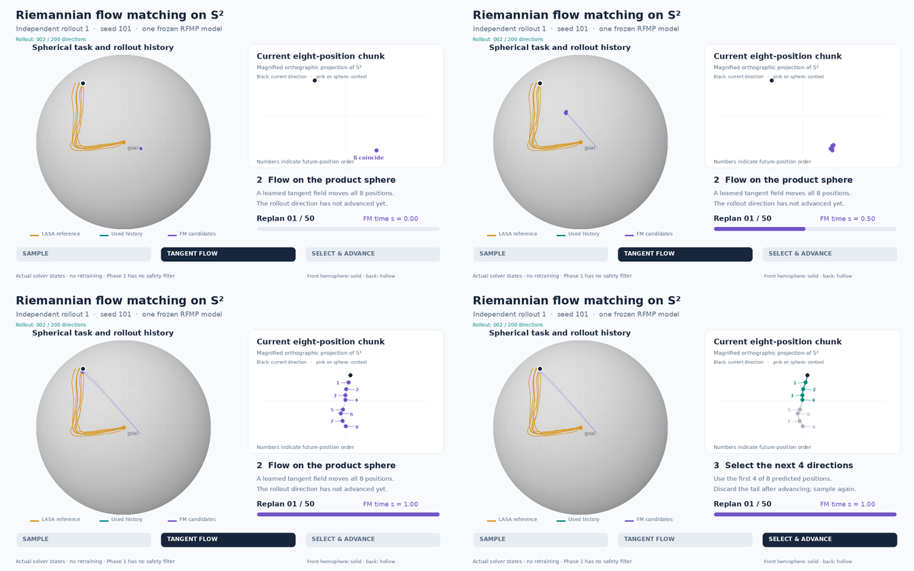
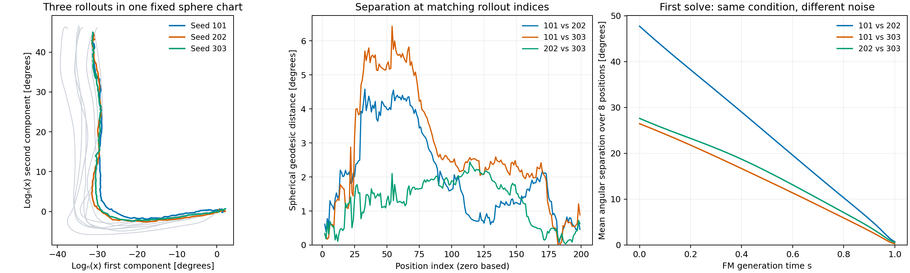

# Phase 1 animated trajectory generation

30 October 2026. Requested by the applicant after freezing the validated baseline. Three independent stochastic rollouts of the **same trained model**, with seeds 101, 202 and 303 and the same two-position bootstrap from recording 0. There is no new training, model tuning or safety extension.

Each MP4 shows an entire 200-direction rollout, including all **50 replanning cycles**, in about **98 seconds** at **1280×800, 24 fps**. The first cycle is slower to explain the method. All three new runs pass the unchanged Phase 1 quality thresholds; they are additional visualizations, not a replacement for the frozen 35-rollout evaluation.

## Videos

- [Video 1 — seed 101](videos/rollout_01_seed_101.mp4)
- [Video 2 — seed 202](videos/rollout_02_seed_202.mp4)
- [Video 3 — seed 303](videos/rollout_03_seed_303.mp4)

The three MP4s are included in `docs/results/videos/`. Exact snapshot records and original render outputs remain in the ignored local directory `runs/phase1-context-expanded/viz/`; those records must be regenerated or supplied separately after cloning. The renderer, explanation, summary manifest and comparison below are also tracked.



## What is happening

1. **Sample:** draw one wrapped-Gaussian point on S² and repeat it over the eight-position chunk. All eight positions initially coincide. Source covariance, checkpoint and sampler are the frozen Phase 1 settings.
2. **Flow:** evolve the joint chunk on `(S²)^8` under the learned tangent vector field, keeping observation/context conditioning fixed during the solve. The left pane shows the sphere and accumulated rollout; the right pane magnifies the orthographic projection to reveal the eight positions. The rollout itself does not advance during this virtual generation time.
3. **Select and advance:** use the first four generated directions, discard the unused tail, and append the used portion to the rollout history. A new source and context are drawn for the next solve. Only the final cycle uses two directions to reach a total of 200.

Orange shows the seven recorded LShape curves as display references only, never as future conditioning; purple shows current FM candidates and faint per-waypoint flow traces; teal shows the used rollout history and selected positions; gray shows the unused tail. Black marks the current rollout direction; the pink ring on the sphere marks its earlier context. Waypoint numbers indicate order, rather than separate independent point flows: the network couples the whole chunk. Solid/hollow markers distinguish front/back hemispheres in the orthographic camera view.

## Measured quality

| Video | Seed | Goal error | Angular DTW | Largest adjacent jump | Result |
| --- | ---: | ---: | ---: | ---: | --- |
| 1 | 101 | 1.647° | 1.395° | 1.229° | Pass |
| 2 | 202 | 2.096° | 0.956° | 1.141° | Pass |
| 3 | 303 | 2.258° | 1.062° | 2.609° | Pass |

The same seven-recording/window-overlap limitations apply as in the [baseline report](phase1_report.md). The three videos are different noise/context realizations, not independent training runs or new held-out demonstrations. There is no safety filter or hardware experiment.

## Why the three trajectories look similar

They are distinct outputs from 150 distinct source draws, using different context indices in 48 of the 50 replans for each pair. The same starting pair and first-solve condition are used in all three videos. Only one closely related motion family, LShape, is learned; new noise does not request a different route family.



The left panel uses the fixed north-pole logarithm chart for display. The other panels measure actual spherical geodesic distances, rather than subtracting ambient coordinates. The two identical bootstrap directions are excluded from the full-rollout statistics.

| Seeds | Mean separation at matching indices | Largest separation | Symmetric nearest-point mean |
| --- | ---: | ---: | ---: |
| 101 vs 202 | 2.067° | 4.581° | 0.825° |
| 101 vs 303 | 2.776° | 6.430° | 0.608° |
| 202 vs 303 | 1.289° | 2.445° | 0.374° |

Matching-index separation includes progress/timing differences. The nearest-point statistic compares curve proximity without requiring matching indices; it is not a general trajectory-diversity score. In the first solve, the three source pairs are 26.46–47.72° apart; their generated eight-position chunks end only 0.28–0.72° apart on average. These three widely separated sources are transported to nearby conditional chunks.

This similarity is consistent with the current reproduction task and is not a duplicated-output bug. It does **not** establish calibrated uncertainty, multimodal coverage or the absence of learned averaging. Three draws cannot validate those properties. See [exact comparison data](trajectory_similarity.json). All analysis uses already saved arrays; no model training, new sampling or changes to the frozen baseline were performed.

## Fidelity checks

The renderer uses the existing public `Phase1Study.rollout` and `generate` interfaces. Each recorded solve is replayed with its exact context and source, and the replayed selected chunk is checked for **bitwise equality** with the rollout output. All 101 actual sphere-exponential Euler states per solve are retained: **150 solves and 15,150 joint snapshots** across three rollouts. All 150 source points are distinct. Every recorded sphere factor is finite and unit-valid.

The first cycle displays every integration-grid state. Later cycles display actual states at steps 0,5,…,100; frame holds adjust playback speed. There are no invented intermediate FM states. Zooming and waypoint-label placement affect only the display. Connecting curves are shortest spherical arcs drawn for visualization; this does not add a physical execution model or a continuous-path guarantee.

All baseline artifacts and source-module hashes are verified against the frozen manifest before/after visualization. The model, numerical update, data/splits and original run outputs remain unchanged. Final videos are checked by complete FFmpeg decoding, frame/codec metadata inspection and visual inspection of decoded frames. This visualization-only script adds no new model or sampler interface; its verification uses exact real-data replay and media checks rather than renderer unit tests.

## Reproduction

The existing environment has Pillow, DejaVu Sans and FFmpeg with libx264. From the repository root:

```bash
# With no existing viz/generation_records.pt, capture and render all three:
PYTHONPATH=src /home/chengrui/miniconda3/envs/latentSafety/bin/python \
  scripts/animate_phase1.py

# Re-render saved exact draws without generating new rollouts:
PYTHONPATH=src /home/chengrui/miniconda3/envs/latentSafety/bin/python \
  scripts/animate_phase1.py --render-only
```

Capturing again refuses to overwrite an existing capture. Rendering deliberately replaces only the video/preview outputs inside `viz/`. The folder contains `generation_records.pt`, evaluation, source/checkpoint/sampler provenance, video hashes, posters and a first-cycle storyboard. The tracked [animation manifest](phase1_animations.json) records the final files and checks. Frozen baseline tag: `phase1-rfmp-lshape-v1`. Phase 2 has not started.
